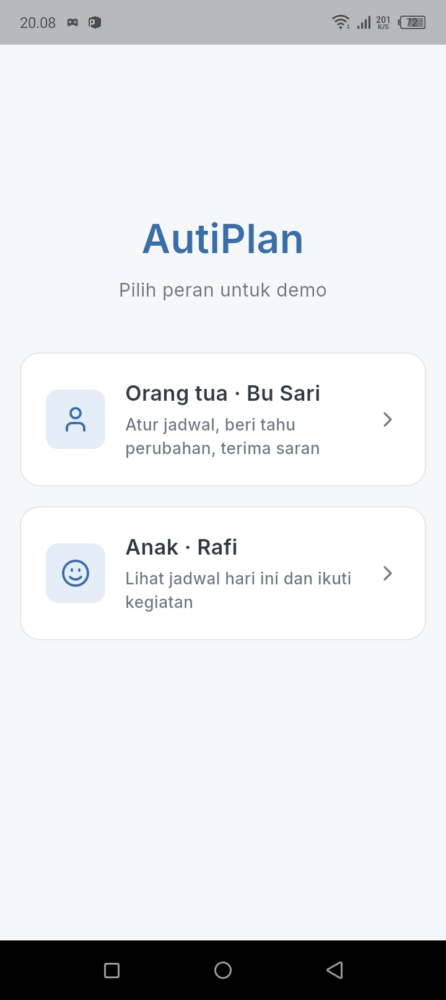
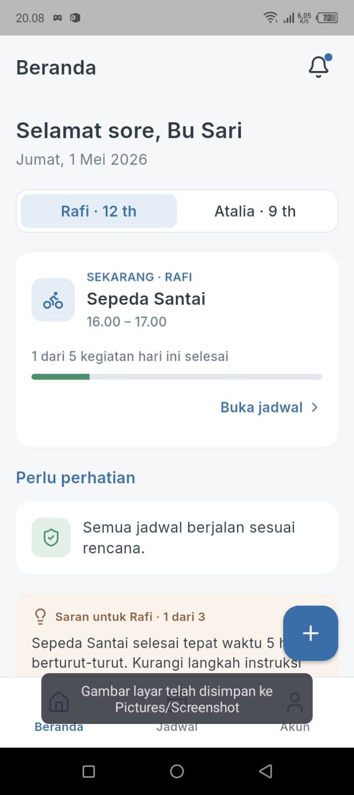
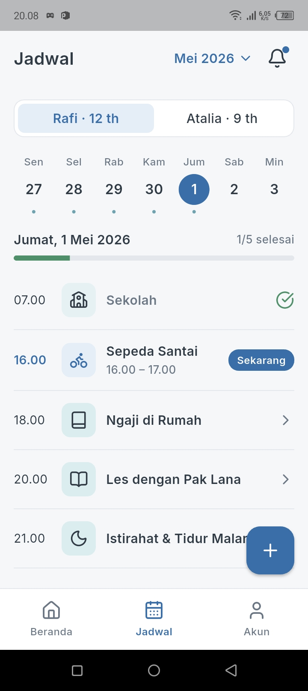
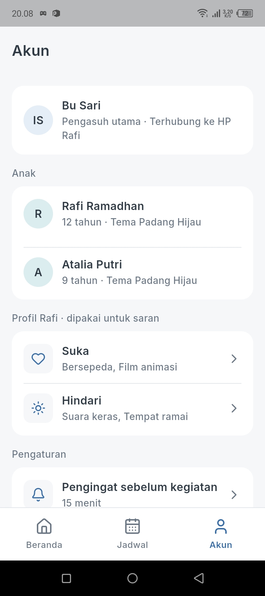
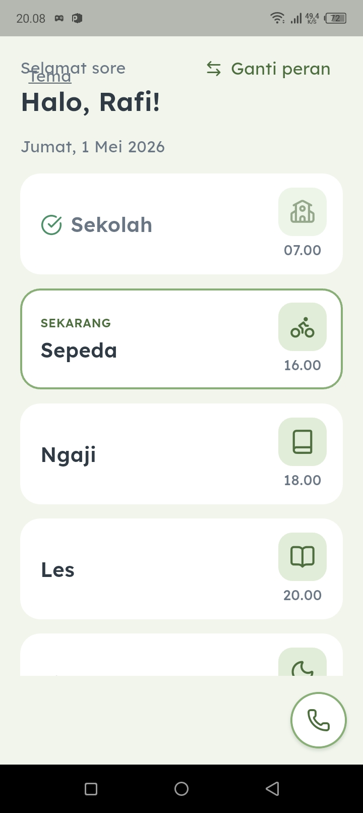
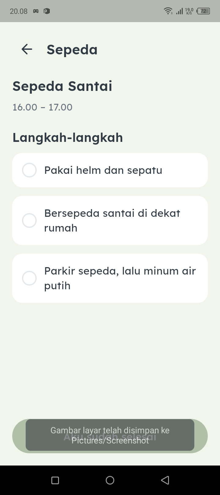
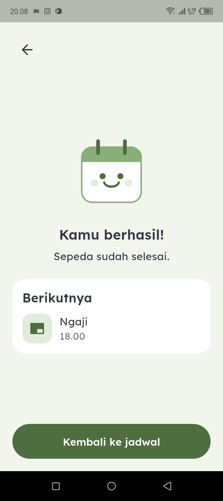
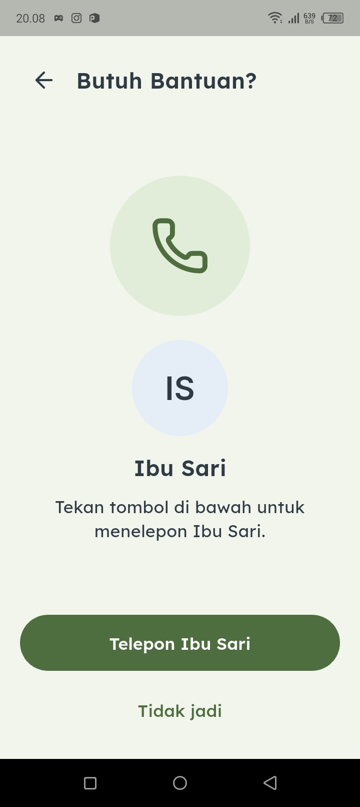
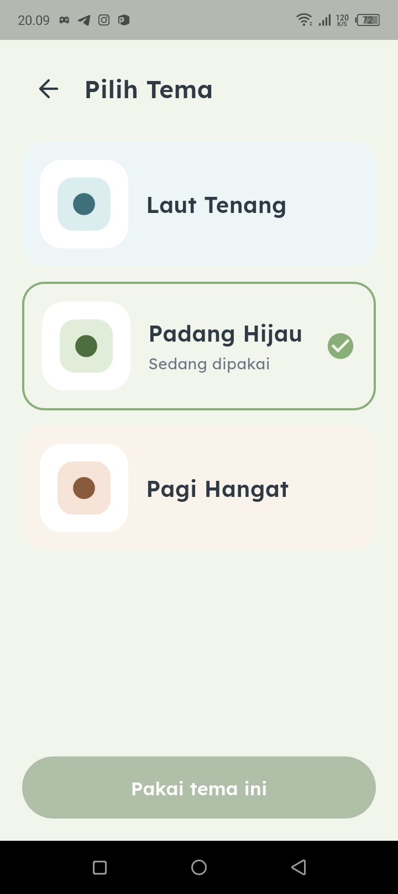

# 🧩 AutiPlan

> **Aplikasi Penjadwalan Visual Ramah Sensorik untuk Anak dengan Autism Spectrum Disorder (ASD) dan Pengasuh (Caregiver)**

[](https://flutter.dev)
[](https://dart.dev)
[](#)
[](#)

---

## 📖 Tentang AutiPlan

Anak dengan spektrum autisme (*Autism Spectrum Disorder* / ASD) memiliki kebutuhan tinggi terhadap prediktabilitas rutinitas harian. Perubahan jadwal yang terjadi secara mendadak sering kali memicu disrupsi kognitif, kebingungan, hingga kecemasan (*anxiety*) dan tantrum. Di sisi lain, orang tua atau pengasuh (*caregiver*) kerap menghadapi tantangan dalam menyusun dan mengomunikasikan perubahan aktivitas tanpa mengejutkan anak.

**AutiPlan** hadir sebagai solusi berbasis *Design Thinking* dan prinsip *Human-Computer Interaction* (HCI/IMK). Aplikasi ini menyediakan sistem penjadwalan visual dua peran (*dual-role*) terintegrasi yang dirancang khusus dengan memperhatikan batasan stimulasi sensorik anak berkebutuhan khusus.

---

## ✨ Fitur Utama

AutiPlan mengintegrasikan dua antarmuka dalam satu ekosistem:

### 1. 👨‍👩‍👧 Sisi Orang Tua / Pengasuh (*Caregiver*)
* **Dashboard & Manajemen Jadwal:** Menyusun, mengubah, dan menghapus jadwal kegiatan harian maupun mingguan dengan mudah.
* **Deteksi Bentrok Otomatis (*Conflict Resolution*):** Mendeteksi jadwal yang bertumpukan secara *real-time* dan memberikan rekomendasi slot waktu luang terdekat.
* **Jeda Transisi & Waktu Tenang (*Quiet Time*):** Menganalisis jeda antar-kegiatan (minimal 10 menit) serta menyarankan waktu istirahat tanpa gawai minimal 30 menit sebelum jam tidur.
* **Mesin Saran Cerdas (*Smart Suggestion Engine*):** Merekomendasikan pengisian hari kosong (*empty day*) dan mode mandiri (*independence mode*) saat anak konsisten menyelesaikan kegiatan tepat waktu.
* **Pemantauan Status (*Real-time Notice*):** Mengetahui secara pasti kapan anak telah membuka dan memahami informasi perubahan jadwal.

### 2. 🧒 Sisi Anak (*Child - Rafi, 12 Tahun*)
* **Antarmuka Tenang & Ramah Sensorik (*Calm Palette*):** Dirancang tanpa warna merah tajam, tanpa hitam pekat (*pure black*), tanpa gradien kontras, serta bebas dari animasi pantul atau getaran yang memicu distorsi sensorik.
* **Pemberitahuan Perubahan Lembut ("Dulu ➔ Sekarang"):** Perubahan jadwal disajikan melalui banner komparatif yang menenangkan—bukan berupa *pop-up* mendadak yang mengejutkan.
* **Ceklis Langkah Terurai (*Step-by-Step Checklist*):** Memecah setiap kegiatan menjadi sub-langkah konkret yang dapat dicentang secara mandiri oleh anak.
* **Tombol Darurat Satu Sentuhan (*Emergency Button*):** Tombol mengambang (*floating*) di pojok kanan bawah yang langsung menghubungkan anak ke panggilan telepon orang tua saat merasa cemas atau butuh bantuan.
* **Personalisasi Tema Visual:** Pilihan warna pastel yang menenangkan sesuai preferensi anak.

---

## 📱 Tangkapan Layar Aplikasi

### 👨‍👩‍👧 Mode Demo & Sisi Pengasuh (Caregiver)
| Pilih Peran Demo | Beranda Pengasuh | Manajemen Jadwal | Profil & Akun |
| :---: | :---: | :---: | :---: |
|  |  |  |  |

### 🧒 Sisi Anak (Ramah Sensorik - Rafi)
| Jadwal Hari Ini | Ceklis Langkah Kegiatan | Apresiasi Selesai (Maskot) | Panggilan Darurat Cepat | Personalisasi Tema |
| :---: | :---: | :---: | :---: | :---: |
|  |  |  |  |  |

---

## 🎨 Prinsip Desain Sensorik (IMK)

Sesuai pedoman desain untuk neurodivergensi:
1. **Prediktabilitas:** Informasi disajikan secara konsisten dengan tata letak horizontal yang mudah dipindai.
2. **Tanpa Distraksi Destruktif:** Sisi anak bersifat *read-only* (tanpa tombol edit/hapus) untuk mencegah salah tekan dan rasa frustrasi.
3. **Satu Aksi Utama per Layar:** Mengurangi beban kognitif (*cognitive load*) anak dalam menentukan tindakan berikutnya.
4. **Tipografi Inklusif:** Menggunakan font **Lexend** (untuk keterbacaan optimal bagi anak) dan **Inter** (antarmuka pengasuh yang bersih).

---

## 🛠️ Arsitektur & Teknologi

* **Framework:** [Flutter](https://flutter.dev) (Dart 3)
* **State Management:** [Riverpod](https://riverpod.dev)
* **Routing:** [GoRouter](https://pub.dev/packages/go_router) (*StatefulShellRoute* untuk navigasi multi-tab)
* **Desain & Ikonografi:** [Lucide Icons](https://lucide.dev)
* **Penyimpanan Lokal:** `LocalRepository` dengan model serialisasi JSON dan data *seed* simulasi.
* **Mode Demo:** Dilengkapi jam demo statis (*Demo Clock*) dan tombol alih peran cepat (*Role Switcher*) untuk keperluan pengujian dan evaluasi.

---

## 📂 Struktur Direktori

```text
lib/
├── core/
│   ├── clock.dart               # Simulasi jam demo
│   ├── router.dart              # Konfigurasi navigasi & rute
│   ├── theme/                   # Token desain (warna, tipografi, radius, spasi)
│   └── widgets/                 # Komponen UI bersama (header, card, buttons, mascot)
├── data/
│   ├── models/                  # Data class (Activity, Child, ChangeNotice, Suggestion)
│   ├── providers.dart           # Provider state Riverpod
│   ├── repository.dart          # Abstraksi repository
│   └── seed.dart                # Data awal untuk pengujian
├── domain/
│   ├── schedule_rules.dart      # Logika bisnis jadwal, bentrok, & validasi
│   └── suggestion_engine.dart   # Algoritma saran otomatis (quiet time, empty day, dll.)
├── features/
│   ├── caregiver/               # Layar & form sisi orang tua (Beranda, Jadwal, Akun, Saran)
│   ├── child/                   # Layar sisi anak (Beranda anak, Aktivitas, Darurat, Tema)
│   ├── role_picker/             # Layar pilih peran (Mode Pengasuh vs Mode Anak)
│   └── dev/                     # Galeri komponen (khusus mode debug)
├── app.dart                     # Inisialisasi MaterialApp
└── main.dart                    # Entry point aplikasi
```

---

## 🚀 Memulai (Getting Started)

### Prasyarat
* [Flutter SDK](https://docs.flutter.dev/get-started/install) (versi stable terbaru)
* [Dart SDK](https://dart.dev/get-dart)
* Android Studio / VS Code dengan ekstensi Flutter & Dart

### Instalasi & Menjalankan Aplikasi

1. **Clone repositori ini:**
   ```bash
   git clone https://github.com/username/autiplan.git
   cd autiplan
   ```

2. **Pasang dependensi:**
   ```bash
   flutter pub get
   ```

3. **Jalankan analisis kode:**
   ```bash
   flutter analyze
   ```

4. **Jalankan pengujian unit & widget:**
   ```bash
   flutter test
   ```

5. **Jalankan aplikasi di emulator atau perangkat fisik:**
   ```bash
   flutter run
   ```

---

## 📊 Hasil Uji Coba Prototipe

Berdasarkan pengujian lapangan (*Usability Testing*) pada mata kuliah **Manajemen Inovasi Pendidikan / IMK**, aplikasi memperoleh tingkat kelayakan keseluruhan sebesar **78,3% (Kategori Baik)** dengan rincian:
* **Isi / Materi:** `86,7%` (Sangat Baik)
* **Kemanfaatan:** `80,0%` (Baik)
* **Kesesuaian Kebutuhan:** `80,0%` (Baik)
* **Keterbacaan Teks & Ikon:** `80,0%` (Baik)
* **Desain Tampilan Sensorik:** `80,0%` (Baik)
* **Kemenarikan Maskot & Tema:** `80,0%` (Baik)
* **Kemudahan Penggunaan:** `73,3%` (Baik)
* **Kepraktisan:** `66,7%` (Baik)

---

## 👥 Tim Pengembang (Kelompok 8)

Proyek ini disusun untuk memenuhi tugas mata kuliah **Manajemen Inovasi**, Program Studi Pendidikan Teknik Informatika / Ilmu Komputer, Universitas Negeri Malang (Offering G6 2026):

| No | Nama | NIM | Peran Utama |
|:--:|---|:--:|---|
| 1 | **Asyam Sakhi Maulana** | `240535600363` | Ketua Tim & Product Lead |
| 2 | **Aditya Ananda Kasi** | `240535606063` | Lead Developer |
| 3 | **Zainur Rohman** | `250611602556` | Fasilitator Pengujian Pengguna |
| 4 | **Muchammad Zainuddin** | `250771623553` | Koordinator Uji Coba |
| 5 | **Martinoes Cristian Saputra** | `250771602183` | Penyusun Instrumen & Analisis Data |

**Dosen Pengampu:** Dr. M. Luthfi Oktarianto, M.Pd., MCE.

---

<p align="center">
  2026
</p>
